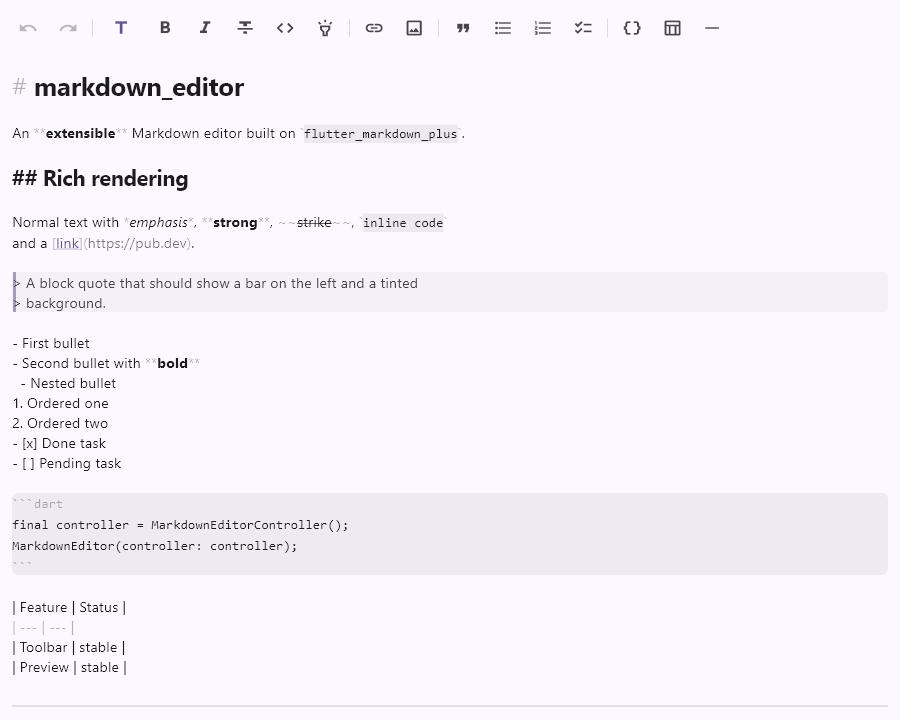
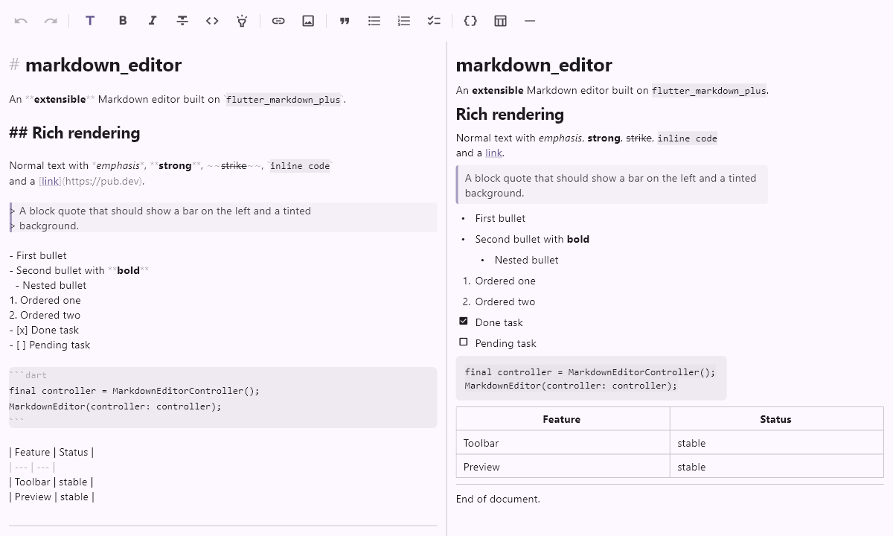

# wysiwyg_markdown_editor

[](LICENSE)

**English** | [简体中文](README.zh-CN.md)

An **extensible, WYSIWYG Markdown editor** for Flutter, built on top of
[`flutter_markdown_plus`](https://pub.flutter-io.cn/packages/flutter_markdown_plus).

You keep editing **plain Markdown source** — no proprietary document model, no
hidden HTML — while the text is rendered as rich text in place: headings,
emphasis, links, inline code, fenced code blocks, quotes, lists, tables and
task lists are styled as you type. A live preview rendered by
`flutter_markdown_plus` shares the same theme.

The second goal of this package is **extensibility**. Every visual element,
command, parser stage and builder is a replaceable object exposed in the public
API: an application can restyle a token, add a new syntax rule, paint its own
block decoration, replace the toolbar, or swap the whole editing surface
without forking the package.





---

## Features

- **WYSIWYG editing on plain source** — the document value is always valid
  Markdown, so it can be saved, diffed or sent anywhere.
- **Live preview** — `MarkdownEditorMode.preview` and `MarkdownEditorMode.split`
  render through `flutter_markdown_plus` with a style sheet derived from the
  editor theme, so editing and previewing look identical.
- **Block decorations** — quote bars, fenced code backgrounds, list guides and
  themed horizontal rules are painted behind the text, aligned with the same
  text layout the editor uses.
- **Toolbar + commands** — undo/redo, headings, bold, italic, strikethrough,
  highlight, inline code, links, images, quotes, bullet/ordered/task lists,
  code blocks, tables and rules. Add your own `MarkdownCommand`s.
- **Keyboard shortcuts** — remappable bindings for every command, optional
  Tab/Shift+Tab indentation.
- **Undo/redo history** — text snapshots with selection restore, coalesced so a
  typed word is one undo step.
- **Theming** — one `MarkdownEditorTheme` drives both the editor and the
  preview; unset fields fall back to the ambient Material theme.
- **Extensible pipeline** — `MarkdownLineAnalyzer` → `MarkdownInlineRule`s →
  `MarkdownSpanEngine` → `MarkdownLineDecorator`s, each replaceable.
- **No platform plugins** — pure Dart/Flutter; works on Android, iOS, Windows,
  macOS, Linux and the web.

## Getting started

```yaml
dependencies:
  wysiwyg_markdown_editor:
    git: https://github.com/electrolysis743/markdown_editor.git
```

> The package is published under GPL-3.0. See [LICENSE](LICENSE).

```dart
import 'package:flutter/material.dart';
import 'package:wysiwyg_markdown_editor/wysiwyg_markdown_editor.dart';

void main() => runApp(const MaterialApp(home: EditorPage()));

class EditorPage extends StatefulWidget {
  const EditorPage({super.key});

  @override
  State<EditorPage> createState() => _EditorPageState();
}

class _EditorPageState extends State<EditorPage> {
  final MarkdownEditorController controller =
      MarkdownEditorController(text: '# Hello Markdown');

  @override
  void dispose() {
    controller.dispose();
    super.dispose();
  }

  @override
  Widget build(BuildContext context) {
    return Scaffold(
      appBar: AppBar(title: const Text('Markdown Editor')),
      body: MarkdownEditor(
        controller: controller,
        mode: MarkdownEditorMode.split,
        onChanged: (String markdown) => debugPrint(markdown),
      ),
    );
  }
}
```

## Modes

| Mode | Description |
| --- | --- |
| `MarkdownEditorMode.wysiwyg` | Rich, in-place styled source editing (default). |
| `MarkdownEditorMode.source` | Plain monospace source editing. |
| `MarkdownEditorMode.preview` | Rendered Markdown only. |
| `MarkdownEditorMode.split` | Editor and live preview side by side (or stacked). |

`splitDirection` and `splitRatio` control the split layout.

## How it works

The editor never edits an abstract syntax tree. It edits the **source text**
and derives a styled `TextSpan` from it:

```
source text
   │
   ├─ MarkdownLineAnalyzer ──▶ MarkdownDocumentLayout  (lines, blocks, offsets)
   │
   ├─ MarkdownInlineRule[]  ──▶ styled ranges          (bold, code, links, …)
   │
   ├─ MarkdownSpanEngine    ──▶ TextSpan               (rendered by the TextField)
   │
   └─ MarkdownLineDecorator[] ─▶ CustomPaint           (quote bars, code backgrounds)
```

Because the span text is always identical to the document, the caret,
selection, IME composition and platform text editing all keep working. Block
decorations are laid out from the same spans as the text, so they stay aligned
while scrolling and resizing.

Markers (`**`, `#`, `>` …) stay in the document; their visibility is controlled
by `MarkdownEditorTheme.markerVisibility`:

- `visible` — syntax as typed.
- `dimmed` — syntax faded (default).
- `hidden` — syntax transparent (layout stays stable because the characters
  keep their width).

## Customization

### Theming

Every token is themeable; unspecified fields fall back to the Material theme.

```dart
MarkdownEditor(
  theme: const MarkdownEditorTheme(
    heading1: TextStyle(fontSize: 34, fontWeight: FontWeight.w800),
    quoteBarColor: Colors.deepPurple,
    codeBlockColor: Color(0x11000000),
    markerVisibility: MarkdownMarkerVisibility.hidden,
  ),
)
```

The preview uses `MarkdownEditorTheme.toMarkdownStyleSheet()`, so the same
theme styles the rendered output.

### Custom syntax rules

```dart
class MentionRule extends MarkdownInlineRule {
  const MentionRule();

  @override
  int get priority => 38;

  @override
  void scan(MarkdownInlineScan scan) {
    for (final RegExpMatch match
        in RegExp(r'@[A-Za-z0-9_]{2,}').allMatches(scan.text, scan.start, scan.end)) {
      scan.add(
        match.start,
        match.end,
        MarkdownTokenType.custom,
        style: const TextStyle(color: Color(0xFF00695C), fontWeight: FontWeight.w600),
      );
    }
  }
}

MarkdownEditor(
  extensions: MarkdownEditorExtensions(
    inlineRules: const [MentionRule()],
  ),
)
```

Rules can call `scan.mask(start, end)` to hide their content from lower priority
rules, and can supply explicit `TextStyle`s or a `payload` for custom rendering.

### Custom decorations

```dart
class CalloutDecorator extends MarkdownLineDecorator {
  const CalloutDecorator();

  @override
  void paint(MarkdownDecorationContext context) {
    for (final MarkdownBlockBox box in context.blockBoxes) {
      if (box.block.kind != MarkdownBlockKind.quote) continue;
      final MarkdownLineInfo line = context.layout.lines[box.block.startLine];
      if (!line.text.contains('[!NOTE]')) continue;
      context.canvas.drawRect(
        Rect.fromLTWH(box.rect.left, box.rect.top, 3, box.rect.height),
        Paint()..color = const Color(0xFFEF6C00),
      );
    }
  }
}
```

`DebugDecorationDecorator` (shipped with the package) draws every line and
block box, which is handy while developing decorations.

### Custom commands and toolbar items

```dart
class InsertSignatureCommand extends MarkdownCommand {
  const InsertSignatureCommand();

  @override
  String get id => 'insert-signature';

  @override
  String get label => 'Signature';

  @override
  IconData? get icon => Icons.draw_outlined;

  @override
  void execute(MarkdownCommandContext context) {
    context.controller.insertBlock('---\n_Sent from Flutter_');
  }
}

MarkdownEditor(
  toolbar: MarkdownToolbarConfig(
    items: [
      ...defaultMarkdownToolbarItems(),
      const MarkdownToolbarItem(
        command: InsertSignatureCommand(),
        icon: Icons.draw_outlined,
      ),
    ],
  ),
)
```

### Replacing whole widgets

```dart
MarkdownEditor(
  builders: MarkdownEditorBuilders(
    toolbarBuilder: (context, toolbar) => MyToolbar(items: toolbar.items),
    editingSurfaceBuilder: (context, surface) => MySurface(
      controller: surface.controller,
      theme: surface.theme,
    ),
    previewBuilder: (context, preview) => MyPreview(
      data: preview.controller.text,
    ),
    emptyStateBuilder: (context) => const Center(child: Text('Start writing')),
    codeBlockBuilder: (context, code) => MyCodeBlock(
      code: code.code,
      language: code.language,
    ),
    imageBuilder: (context, image) => MyImage(uri: image.uri),
    checkboxBuilder: (context, value) => MyCheckbox(value: value),
  ),
)
```

### `flutter_markdown_plus` passthrough

The preview forwards the upstream extension points:

```dart
MarkdownEditor(
  builders: MarkdownEditorBuilders(
    inlineSyntaxes: [MarkSyntax()],
    elementBuilders: {'mark': MarkElementBuilder()},
    syntaxHighlighter: MyHighlighter(),   // implement flutter_markdown_plus SyntaxHighlighter
    extensionSet: md.ExtensionSet.gitHubWeb,
  ),
)
```

### Shortcuts

```dart
MarkdownEditor(
  shortcutBindings: <ShortcutActivator, MarkdownCommand>{
    const SingleActivator(LogicalKeyboardKey.keyB, meta: true):
        const BoldCommand(),
  },
  enableTabIndentation: true,
)
```

### Controller API

`MarkdownEditorController` is a regular `TextEditingController`, so it works
with any text widget, and adds:

```dart
controller.text;                       // the Markdown source
controller.layout;                     // parsed lines/blocks
controller.selectionLines;             // lines touched by the selection
controller.toggleInlineWrap(marker: '**');
controller.setHeadingLevel(2);
controller.toggleBulletList();
controller.toggleOrderedList();
controller.toggleTaskList();
controller.toggleTaskState();
controller.toggleBlockquote();
controller.indentLines();
controller.outdentLines();
controller.insertBlock('> quote');
controller.undo();
controller.redo();
controller.history;
```

## Package layout

```
lib/
  wysiwyg_markdown_editor.dart      # public barrel
  src/
    analysis/                       # line analyzer, inline rules, span engine
    commands/                       # MarkdownCommand + built-in commands
    controller/                     # MarkdownEditorController, history
    decoration/                     # decoration painter + default decorators
    editor/                         # extensions, builders, scope
    model/                          # line, block and layout models
    theme/                          # MarkdownEditorTheme, marker visibility
    toolbar/                        # toolbar widget, items, theme
    widgets/                        # surface, preview, shortcuts
```

An interactive demo of every extension point lives in [`example/`](example).

## Extending the parser

Implement `MarkdownLineAnalyzer` and pass it through
`MarkdownEditorExtensions.lineAnalyzer` to support a Markdown dialect, or
implement `MarkdownSpanEngine` to replace how tokens become spans (for example
to render with inline widgets).

## Limitations

- Markdown markers remain part of the text, so "hidden" markers still occupy
  their width. True zero-width hiding would break caret and selection offsets.
- Setext headings (`Title` + `=====`) are shown as paragraphs in the editor;
  the preview still renders them. ATX headings are fully supported.
- The editing surface styles lines, not nested inline widgets: images are shown
  as their Markdown source in the editor and rendered in the preview.
- Complex tables are rendered by `flutter_markdown_plus` in the preview; the
  editor styles them as source lines with delimiter highlighting.

## Contributing

Issues and pull requests are welcome. Please run

```bash
flutter analyze --no-fatal-infos
flutter test
```

before opening a pull request.

## Releasing

1. Update `version` in `pubspec.yaml` and `CHANGELOG.md`.
2. Set `repository` (or `homepage`) in `pubspec.yaml` to the public repository
   URL; pub.dev warns when both are missing.
3. Run `dart pub publish --dry-run` to inspect the archive, then
   `dart pub publish`.

## License

Copyright (C) 2026 wysiwyg_markdown_editor contributors.

This program is free software: you can redistribute it and/or modify it under
the terms of the GNU General Public License as published by the Free Software
Foundation, either version 3 of the License, or (at your option) any later
version.

This program is distributed in the hope that it will be useful, but **without
any warranty**; without even the implied warranty of merchantability or fitness
for a particular purpose. See the GNU General Public License for more details.

The full license text is in [LICENSE](LICENSE).
