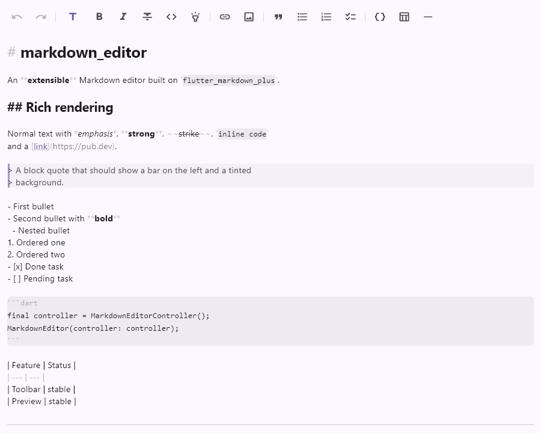
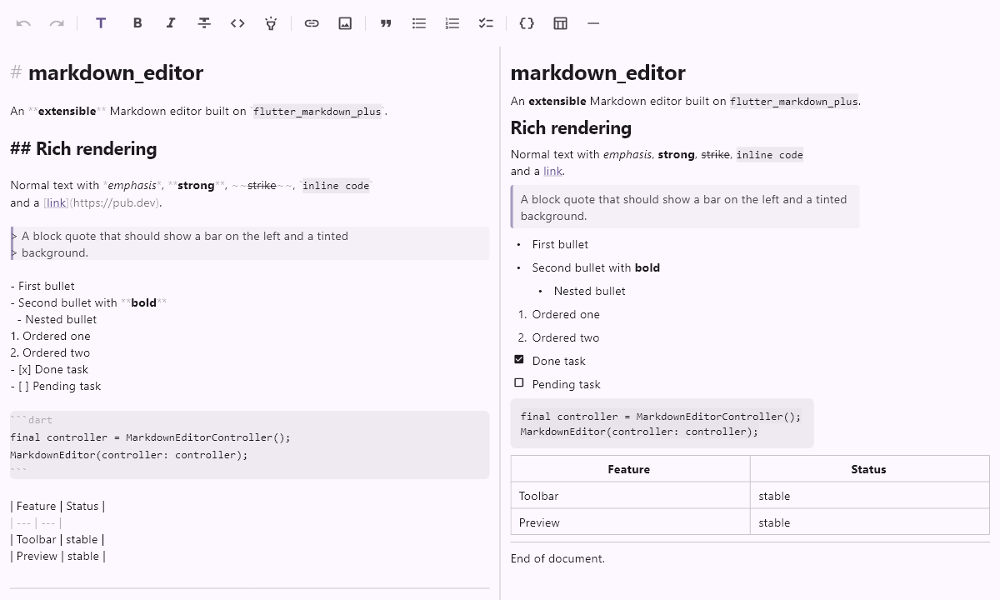

# wysiwyg_markdown_editor

[](LICENSE)

[English](README.md) | **简体中文**

一个面向 Flutter 的**可扩展、所见即所得（WYSIWYG）Markdown 编辑器**，基于
[`flutter_markdown_plus`](https://pub.flutter-io.cn/packages/flutter_markdown_plus) 构建。

你始终在编辑**纯 Markdown 源码**——没有私有文档模型，也没有隐藏的 HTML——而文本
会就地渲染为富文本：标题、强调、链接、行内代码、围栏代码块、引用、列表、表格和
任务列表都随输入即时应用样式。由 `flutter_markdown_plus` 渲染的实时预览与编辑器
共用同一套主题。

本包的第二个目标是**可扩展性**。每一个视觉元素、命令、解析阶段和构建器都是公开
API 中可替换的对象：应用可以重新设置某个 token 的样式、添加新的语法规则、绘制自己
的块级装饰、替换工具栏，甚至整体替换编辑画布，而无需 fork 本包。





---

## 功能特性

- **基于纯源码的所见即所得编辑** —— 文档值始终是合法的 Markdown，可以随时保存、
  做 diff 或发送到任何地方。
- **实时预览** —— `MarkdownEditorMode.preview` 与 `MarkdownEditorMode.split` 通过
  `flutter_markdown_plus` 渲染，样式表由编辑器主题推导而来，因此编辑与预览外观
  完全一致。
- **块级装饰** —— 引用条、围栏代码背景、列表缩进引导线以及随主题变化的分割线绘制
  在文字背后，并与编辑器使用的文本布局对齐。
- **工具栏 + 命令** —— 撤销/重做、标题、粗体、斜体、删除线、高亮、行内代码、链接、
  图片、引用、无序/有序/任务列表、代码块、表格和分割线。也可以添加自定义的
  `MarkdownCommand`。
- **键盘快捷键** —— 每个命令的按键绑定都可重映射，可选启用 Tab/Shift+Tab 缩进。
- **撤销/重做历史** —— 基于文本快照并恢复选区，按词合并，输入一个单词只产生一步
  撤销。
- **主题** —— 一个 `MarkdownEditorTheme` 同时驱动编辑器与预览；未设置的字段回退到
  环境中的 Material 主题。
- **可扩展的处理管线** —— `MarkdownLineAnalyzer` → `MarkdownInlineRule` →
  `MarkdownSpanEngine` → `MarkdownLineDecorator`，每一级都可替换。
- **无平台插件** —— 纯 Dart/Flutter 实现；支持 Android、iOS、Windows、macOS、
  Linux 和 Web。

## 快速开始

```yaml
dependencies:
  wysiwyg_markdown_editor:
    git: https://github.com/electrolysis743/markdown_editor.git
```

> 本包以 GPL-3.0 协议发布。参见 [LICENSE](LICENSE)。

```dart
import 'package:flutter/material.dart';
import 'package:wysiwyg_markdown_editor/wysiwyg_markdown_editor.dart';

void main() => runApp(const MaterialApp(home: EditorPage()));

class EditorPage extends StatefulWidget {
  const EditorPage({super.key});

  @override
  State<EditorPage> createState() => _EditorPageState();
}

class _EditorPageState extends State<EditorPage> {
  final MarkdownEditorController controller =
      MarkdownEditorController(text: '# Hello Markdown');

  @override
  void dispose() {
    controller.dispose();
    super.dispose();
  }

  @override
  Widget build(BuildContext context) {
    return Scaffold(
      appBar: AppBar(title: const Text('Markdown Editor')),
      body: MarkdownEditor(
        controller: controller,
        mode: MarkdownEditorMode.split,
        onChanged: (String markdown) => debugPrint(markdown),
      ),
    );
  }
}
```

## 编辑模式

| 模式 | 说明 |
| --- | --- |
| `MarkdownEditorMode.wysiwyg` | 就地应用样式的富文本源码编辑（默认）。 |
| `MarkdownEditorMode.source` | 等宽字体的纯源码编辑。 |
| `MarkdownEditorMode.preview` | 仅显示渲染后的 Markdown。 |
| `MarkdownEditorMode.split` | 编辑器与实时预览并排（或上下）显示。 |

`splitDirection` 与 `splitRatio` 控制分屏布局。

## 工作原理

编辑器从不编辑抽象语法树，而是编辑**源文本**，并由源文本推导出带样式的
`TextSpan`：

```
source text
   │
   ├─ MarkdownLineAnalyzer ──▶ MarkdownDocumentLayout  (lines, blocks, offsets)
   │
   ├─ MarkdownInlineRule[]  ──▶ styled ranges          (bold, code, links, …)
   │
   ├─ MarkdownSpanEngine    ──▶ TextSpan               (rendered by the TextField)
   │
   └─ MarkdownLineDecorator[] ─▶ CustomPaint           (quote bars, code backgrounds)
```

由于 span 的文本始终与文档完全一致，光标、选区、输入法组合以及平台文本编辑功能
都能正常工作。块级装饰基于与文字相同的 span 布局，因此在滚动和调整尺寸时始终保持
对齐。

标记符（`**`、`#`、`>` …）保留在文档中，其可见性由
`MarkdownEditorTheme.markerVisibility` 控制：

- `visible` —— 按输入原样显示语法。
- `dimmed` —— 语法淡化显示（默认）。
- `hidden` —— 语法透明显示（字符仍占用宽度，因此布局保持稳定）。

## 自定义

### 主题

每个 token 都可主题化；未指定的字段回退到 Material 主题。

```dart
MarkdownEditor(
  theme: const MarkdownEditorTheme(
    heading1: TextStyle(fontSize: 34, fontWeight: FontWeight.w800),
    quoteBarColor: Colors.deepPurple,
    codeBlockColor: Color(0x11000000),
    markerVisibility: MarkdownMarkerVisibility.hidden,
  ),
)
```

预览使用 `MarkdownEditorTheme.toMarkdownStyleSheet()`，因此同一套主题同样作用于
渲染后的输出。

### 自定义语法规则

```dart
class MentionRule extends MarkdownInlineRule {
  const MentionRule();

  @override
  int get priority => 38;

  @override
  void scan(MarkdownInlineScan scan) {
    for (final RegExpMatch match
        in RegExp(r'@[A-Za-z0-9_]{2,}').allMatches(scan.text, scan.start, scan.end)) {
      scan.add(
        match.start,
        match.end,
        MarkdownTokenType.custom,
        style: const TextStyle(color: Color(0xFF00695C), fontWeight: FontWeight.w600),
      );
    }
  }
}

MarkdownEditor(
  extensions: MarkdownEditorExtensions(
    inlineRules: const [MentionRule()],
  ),
)
```

规则可以调用 `scan.mask(start, end)` 让自身内容对优先级更低的规则不可见，也可以
提供显式的 `TextStyle` 或 `payload` 用于自定义渲染。

### 自定义装饰

```dart
class CalloutDecorator extends MarkdownLineDecorator {
  const CalloutDecorator();

  @override
  void paint(MarkdownDecorationContext context) {
    for (final MarkdownBlockBox box in context.blockBoxes) {
      if (box.block.kind != MarkdownBlockKind.quote) continue;
      final MarkdownLineInfo line = context.layout.lines[box.block.startLine];
      if (!line.text.contains('[!NOTE]')) continue;
      context.canvas.drawRect(
        Rect.fromLTWH(box.rect.left, box.rect.top, 3, box.rect.height),
        Paint()..color = const Color(0xFFEF6C00),
      );
    }
  }
}
```

随包提供的 `DebugDecorationDecorator` 会绘制所有行与块的边界框，在开发装饰时非常
有用。

### 自定义命令与工具栏项

```dart
class InsertSignatureCommand extends MarkdownCommand {
  const InsertSignatureCommand();

  @override
  String get id => 'insert-signature';

  @override
  String get label => 'Signature';

  @override
  IconData? get icon => Icons.draw_outlined;

  @override
  void execute(MarkdownCommandContext context) {
    context.controller.insertBlock('---\n_Sent from Flutter_');
  }
}

MarkdownEditor(
  toolbar: MarkdownToolbarConfig(
    items: [
      ...defaultMarkdownToolbarItems(),
      const MarkdownToolbarItem(
        command: InsertSignatureCommand(),
        icon: Icons.draw_outlined,
      ),
    ],
  ),
)
```

### 替换整个 Widget

```dart
MarkdownEditor(
  builders: MarkdownEditorBuilders(
    toolbarBuilder: (context, toolbar) => MyToolbar(items: toolbar.items),
    editingSurfaceBuilder: (context, surface) => MySurface(
      controller: surface.controller,
      theme: surface.theme,
    ),
    previewBuilder: (context, preview) => MyPreview(
      data: preview.controller.text,
    ),
    emptyStateBuilder: (context) => const Center(child: Text('Start writing')),
    codeBlockBuilder: (context, code) => MyCodeBlock(
      code: code.code,
      language: code.language,
    ),
    imageBuilder: (context, image) => MyImage(uri: image.uri),
    checkboxBuilder: (context, value) => MyCheckbox(value: value),
  ),
)
```

### 透传 `flutter_markdown_plus`

预览会转发上游的扩展点：

```dart
MarkdownEditor(
  builders: MarkdownEditorBuilders(
    inlineSyntaxes: [MarkSyntax()],
    elementBuilders: {'mark': MarkElementBuilder()},
    syntaxHighlighter: MyHighlighter(),   // implement flutter_markdown_plus SyntaxHighlighter
    extensionSet: md.ExtensionSet.gitHubWeb,
  ),
)
```

### 快捷键

```dart
MarkdownEditor(
  shortcutBindings: <ShortcutActivator, MarkdownCommand>{
    const SingleActivator(LogicalKeyboardKey.keyB, meta: true):
        const BoldCommand(),
  },
  enableTabIndentation: true,
)
```

### 控制器 API

`MarkdownEditorController` 本身就是一个 `TextEditingController`，因此可与任何文本
组件配合使用，并额外提供：

```dart
controller.text;                       // the Markdown source
controller.layout;                     // parsed lines/blocks
controller.selectionLines;             // lines touched by the selection
controller.toggleInlineWrap(marker: '**');
controller.setHeadingLevel(2);
controller.toggleBulletList();
controller.toggleOrderedList();
controller.toggleTaskList();
controller.toggleTaskState();
controller.toggleBlockquote();
controller.indentLines();
controller.outdentLines();
controller.insertBlock('> quote');
controller.undo();
controller.redo();
controller.history;
```

## 包结构

```
lib/
  wysiwyg_markdown_editor.dart      # public barrel
  src/
    analysis/                       # line analyzer, inline rules, span engine
    commands/                       # MarkdownCommand + built-in commands
    controller/                     # MarkdownEditorController, history
    decoration/                     # decoration painter + default decorators
    editor/                         # extensions, builders, scope
    model/                          # line, block and layout models
    theme/                          # MarkdownEditorTheme, marker visibility
    toolbar/                        # toolbar widget, items, theme
    widgets/                        # surface, preview, shortcuts
```

每个扩展点的可交互示例见 [`example/`](example)。

## 扩展解析器

实现 `MarkdownLineAnalyzer` 并通过 `MarkdownEditorExtensions.lineAnalyzer` 传入，
即可支持某种 Markdown 方言；也可以实现 `MarkdownSpanEngine` 来替换 token 转换为
span 的方式（例如用行内 Widget 渲染）。

## 已知限制

- Markdown 标记符仍是文本的一部分，因此“隐藏”的标记符依然占据自身宽度。真正的
  零宽隐藏会破坏光标与选区的偏移。
- Setext 标题（`Title` + `=====`）在编辑器中按段落显示，预览仍能正确渲染。ATX
  标题已被完整支持。
- 编辑画布只为整行设置样式，不支持嵌套的行内 Widget：图片在编辑器中显示为其
  Markdown 源码，在预览中渲染为图片。
- 复杂表格由 `flutter_markdown_plus` 在预览中渲染；编辑器将其作为源码行显示，
  并对分隔行进行高亮。

## 参与贡献

欢迎提交 issue 和 pull request。提交 pull request 前请先运行：

```bash
flutter analyze
flutter test
```

## 发布

1. 更新 `pubspec.yaml` 与 `CHANGELOG.md` 中的 `version`。
2. 在 `pubspec.yaml` 中把 `repository`（或 `homepage`）设为公开仓库地址；两者都缺失
   时 pub.dev 会给出警告。
3. 运行 `dart pub publish --dry-run` 检查发布内容，然后执行
   `dart pub publish`。

## 许可证

Copyright (C) 2026 wysiwyg_markdown_editor contributors.

本程序是自由软件：你可以依据自由软件基金会发布的 GNU 通用公共许可证（GPL）第 3
版或（按你的选择）任何更新版本的条款，重新分发和/或修改它。

本程序的分发是希望它有用，但**不提供任何担保**；甚至不提供适销性或特定用途适用性
的默示担保。更多细节参见 GNU 通用公共许可证。

完整许可证文本见 [LICENSE](LICENSE)。
